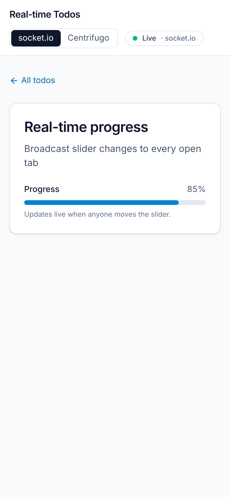

# Real-time Todos

[](https://github.com/dianaasamkova/socket-todos/actions/workflows/ci.yml)

A shared todo board in React: progress, new todos and deletes sync live between everyone who has it open, over socket.io or Centrifugo.


<sub>Another user just moved “Real-time progress” to 85%, and the card highlights the change. Data comes from the bundled mock server.</sub>

> **Context:** a 2024 take-home on real-time state (React 18, Create React App, MUI, socket.io), revisited in 2026. The original backend wasn't in the repo, so I wrote a mock server with the same contract. Then I rebuilt the client with Vite, TanStack Query and Tailwind, added Centrifugo as a second transport, and covered it with tests from unit level to two-browser end-to-end. [TECH.md](TECH.md) explains the decisions.

## Highlights

- **One realtime interface, two transports.** `/` uses socket.io and `/centrifugo` uses Centrifugo. The pages are identical. The mock API publishes every write to both, so a tab on each page stays in sync ([`src/features/realtime/types.ts`](src/features/realtime/types.ts)).
- **No lost updates after a disconnect.** socket.io's connection state recovery and Centrifugo's channel history replay missed events. When they can't, the client refetches the list. A Playwright test cuts a page's connection to prove it.
- **One ordering rule.** Every write gets the next server revision, and the client applies changes strictly in that order. Duplicates and echoes are ignored, a change that skips ahead waits until the gap fills, and an older list response can't undo newer data ([`src/features/todos/cache.ts`](src/features/todos/cache.ts), unit-tested pure functions).
- **Optimistic edits without rollback code.** Renames, progress changes and deletes show instantly because unsaved edits are layered over the server state at display time. If the server refuses one, the layer simply goes away and a message says why ([`src/features/todos/queries.ts`](src/features/todos/queries.ts)).
- **Saving that suits a slider.** Dragging sends one request per pause, after 1 s. If you leave the page, a pending save goes out immediately; if you delete the todo, it's dropped.
- **Product details:** a live connection status, highlights on todos someone else changed, a Done state at 100% with filters kept in the URL, Undo after delete, and loading, error and empty states with Retry.
- **Accessible and tested:** named sliders and buttons, visible focus, and no axe violations on any page. a Vitest suite at 100% coverage (enforced in CI), plus Playwright tests for two-user sync, reconnect catch-up and a keyboard-only flow.

## Tech stack

React 19 · TypeScript 6 · Vite 8 · TanStack Query 5 · React Router 8 · Tailwind CSS 4 · Radix Slider · socket.io 4 · Centrifugo 6 · Vitest 5 + Testing Library + MSW · Playwright · Node 22 mock server

## Quick start

Requires Node 22.18 or later, because the mock server runs TypeScript directly (`nvm use` picks it up from `.nvmrc`, and `npm install` refuses older versions). Docker is only needed for the Centrifugo page.

```bash
npm install
```

```bash
npm run server     # mock API + socket.io on http://localhost:8000
```

```bash
npm run dev        # app on http://localhost:5173
```

Open the app in two windows and move a slider in one: the other window follows about a second later.

To try the Centrifugo page, start Centrifugo, then open <http://localhost:5173/centrifugo>:

```bash
docker compose up -d     # Centrifugo on http://localhost:8001
```

Without Centrifugo, that page shows "Reconnecting…" and the socket.io page works as usual.



## Scripts

| Script                            | What it does                                                                                                                        |
| --------------------------------- | ----------------------------------------------------------------------------------------------------------------------------------- |
| `npm run dev`                     | Vite dev server on port 5173                                                                                                        |
| `npm run server`                  | Mock API, socket.io and Centrifugo publisher on port 8000                                                                           |
| `npm run build`                   | Production build into `dist/`                                                                                                       |
| `npm run preview`                 | Serves the build on port 4173                                                                                                       |
| `npm test`                        | Unit, component and server tests (Vitest)                                                                                           |
| `npm run coverage`                | Tests with a coverage report                                                                                                        |
| `npm run e2e`                     | Playwright tests; starts the API and a production build itself. Add `E2E_CENTRIFUGO=1` with Centrifugo running to include its tests |
| `npm run lint`                    | ESLint                                                                                                                              |
| `npm run typecheck`               | TypeScript for the app and for Node code (server, configs, e2e)                                                                     |
| `npm run format` / `format:check` | Prettier                                                                                                                            |

## Configuration

| Variable                                        | Default                                       | Used by                                                                                        |
| ----------------------------------------------- | --------------------------------------------- | ---------------------------------------------------------------------------------------------- |
| `VITE_API_URL`                                  | `http://localhost:8000`                       | App: REST API and socket.io                                                                    |
| `VITE_CENTRIFUGO_URL`                           | `ws://localhost:8001/connection/websocket`    | App: Centrifugo endpoint                                                                       |
| `PORT`                                          | `8000`                                        | Server                                                                                         |
| `CLIENT_ORIGINS`                                | `http://localhost:5173,http://localhost:4173` | Server: CORS and socket.io. Keep it in sync with `allowed_origins` in `centrifugo/config.json` |
| `CENTRIFUGO_API_URL`                            | `http://localhost:8001`                       | Server: where to publish. An empty value disables Centrifugo                                   |
| `CENTRIFUGO_API_KEY`, `CENTRIFUGO_TOKEN_SECRET` | match `centrifugo/config.json`                | Server. These are local development values, not secrets                                        |

## API contract

| Method   | Path                    | Response                           | Realtime event                      |
| -------- | ----------------------- | ---------------------------------- | ----------------------------------- |
| `GET`    | `/api/todos`            | `{ revision, todos: Todo[] }`      |                                     |
| `GET`    | `/api/revision`         | `{ revision }`                     |                                     |
| `POST`   | `/api/todos`            | `201` change                       | `todo:created` `{ todo, revision }` |
| `PATCH`  | `/api/todos/:id`        | `200` change                       | `todo:updated` `{ todo, revision }` |
| `DELETE` | `/api/todos/:id`        | `200` change                       | `todo:deleted` `{ _id, revision }`  |
| `GET`    | `/api/centrifugo/token` | `{ token }` (HS256 connection JWT) |                                     |

`Todo = { _id, name, description, progress (0–100) }`. The server owns `_id` and a global `revision` that goes up by one with every write. A write's response is the same change object it broadcasts, with an `origin` field holding the writer's `X-Client-Id` header, so a tab can tell its own echo from someone else's change. Invalid input gets a `400` with a `message`, and a body over 10 KB gets a `413`. socket.io emits each event under its type. Centrifugo publishes it to the `todos` channel. The types are shared by client and server in [`contract/todos.ts`](contract/todos.ts).

## Project structure

Client code is organised by feature: everything about todos lives in `features/todos`, everything about the live connection in `features/realtime`. Unit tests sit next to the file they cover; tests that drive the whole app are in each feature's `__tests__/`.

```
contract/todos.ts               # API types shared by the client and the mock server
server/                         # Mock backend (Node, TypeScript): store, REST, socket.io, Centrifugo publisher
centrifugo/config.json          # Centrifugo config for docker compose (history + recovery)
e2e/                            # Playwright: two-user sync, reconnect, accessibility
src/
├── app/                        # App shell: entry, providers, router, query client, config, layout
├── features/
│   ├── todos/
│   │   ├── api.ts              # fetch client with readable errors
│   │   ├── cache.ts            # the ordering rule, as pure functions
│   │   ├── queries.ts          # useTodos and the create / update / delete mutations
│   │   ├── use-undoable-delete.ts
│   │   ├── components/         # TodoCard, AddTodoForm, LoadStatus
│   │   ├── pages/              # list page (filters, add form), detail page
│   │   └── __tests__/          # todo-list, todo-detail, optimistic-edits
│   └── realtime/
│       ├── types.ts            # the RealtimeTransport interface
│       ├── RealtimeProvider.tsx
│       ├── transports/         # socket.io and Centrifugo implementations (Centrifugo is loaded on demand)
│       ├── components/         # ConnectionStatus
│       └── __tests__/          # live-sync, catch-up, change-ordering
├── shared/                     # ui/ primitives (shadcn-style), notices, hooks, cn
└── test/                       # MSW API mock, fake socket.io and Centrifugo clients, render helper
```

Imports use `@/` for `src/` and `@contract/` for the API types. Components use PascalCase file names, everything else kebab-case.

## Docs

- [TECH.md](TECH.md): problem and acceptance criteria, architecture diagrams, decisions and trade-offs, accessibility, testing strategy, a 2026 retrospective, and a roadmap.
