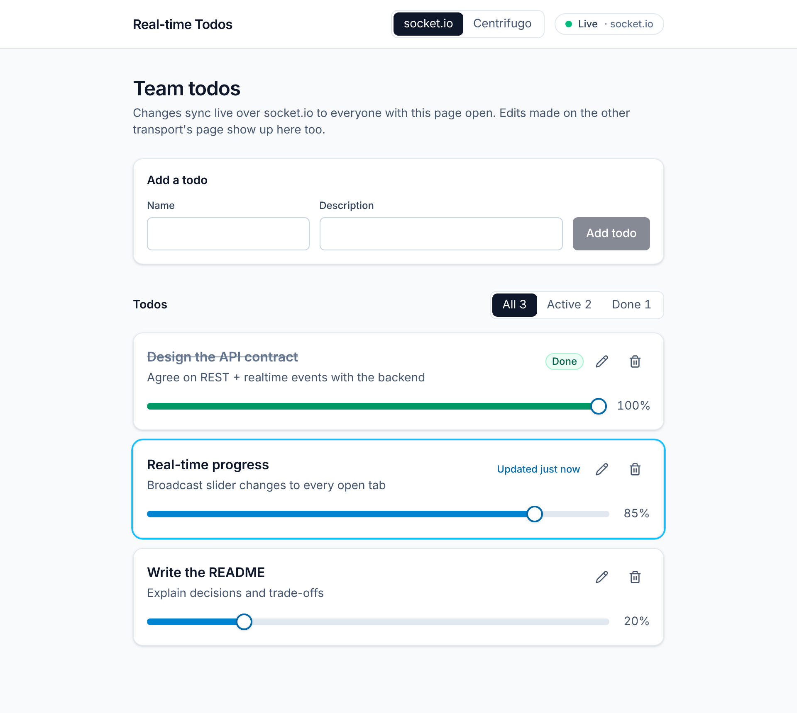

# Real-time Todos

[](https://github.com/dianaasamkova/socket-todos/actions/workflows/ci.yml)

A collaborative todo list in React and socket.io: drag a task's progress slider in one tab, and every other open tab updates live.



> **Context:** a 2024 take-home assignment focused on real-time state. The backend was provided separately, so in 2026 I added a small mock server with the same contract. The repo now runs on its own, with tests and CI. See [TECH.md](TECH.md) for decisions and trade-offs.

## Highlights

- **Real-time sync over WebSocket.** The server pushes `update-todo-progress`, and the client patches only the affected todo.
- **Debounced writes.** The slider moves instantly, but the app sends one `PUT` per pause (1 s), not one per pixel of drag.
- **Remote updates and local edits combined.** Each card keeps local slider state and re-syncs when a remote update arrives.
- **Full CRUD.** Create, inline-rename, delete, and a detail page per todo (`/todo/:id`) with React Router 6.
- **Clear state boundaries.** `TodosProvider` owns the data; `SocketProvider` only turns socket events into state updates.
- **Tested real-time path.** The test pushes a socket event and checks that only the targeted todo's slider changes.

## Tech stack

React 18 · TypeScript · socket.io-client 4 · React Router 6 · MUI 5 · axios · Jest + Testing Library · Create React App

## Quick start

Requires Node 18+ and Yarn 1. Use two terminals:

```bash
yarn install
yarn server       # mock API + socket.io on http://localhost:8000
```

```bash
yarn start        # app on http://localhost:3000
```

Open the app in two tabs and move a slider in one: the other tab follows about a second later.

```bash
yarn test         # tests
yarn build        # production build
```

## API contract

| Method   | Path                   | Response                           |
| -------- | ---------------------- | ---------------------------------- |
| `GET`    | `/api/todos`           | `ITodo[]`                          |
| `POST`   | `/api/todos`           | created `ITodo`                    |
| `PUT`    | `/api/todos`           | full `ITodo[]`                     |
| `DELETE` | `/api/todos/:id`       | `204`                              |
| socket   | `update-todo-progress` | `{ _id, progress }` to all clients |

`ITodo = { _id: string; name: string; description: string; progress: number }`

## Project structure

```
server/index.js            # Mock backend: REST + socket.io, in memory
src/
├── context/ToDosContext.tsx     # Todos state, initial fetch
├── providers/SocketProvider.tsx # Socket → state updates
├── pages/HomePage, ToDoPage     # List with CRUD; detail page
└── components/Card, Form        # Todo card (slider, inline edit); create form
```

## Docs

- [TECH.md](TECH.md): architecture, real-time data flow, decisions and trade-offs, a 2026 retrospective, and a roadmap.
