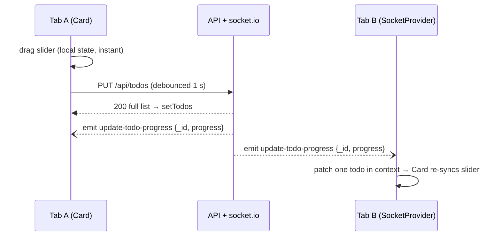

# Real-time Todos: Technical Notes

## 1. Problem

Build a todo client where task progress is shared live: when one user changes a task's progress, everyone looking at the list sees it without reloading.

**Acceptance criteria**

- Todos load from the REST API and can be created, renamed and deleted.
- Each todo has a progress slider (0–100). Moving it saves the new value.
- A progress change made anywhere appears in every open client in real time.
- Each todo has its own page at `/todo/:id`.

## 2. Architecture

**Providers**

- `TodosProvider` owns `todos` and loads them once on mount.
- `SocketProvider` sits inside it, opens one connection, and turns each event into a functional `setTodos` that patches a single todo by `_id`. It disconnects on unmount.
- `RouterProvider` is innermost, so both pages share the same live state.

**Card**

- Local `slider` state keeps dragging smooth.
- The PUT is debounced (`lodash.debounce`, 1 s).
- An effect on `item.progress` re-syncs the slider when a remote update arrives.

## 3. Key decisions

| Decision                                      | Why                                                 | Trade-off                                                                                                                                                                   |
| --------------------------------------------- | --------------------------------------------------- | --------------------------------------------------------------------------------------------------------------------------------------------------------------------------- |
| Context API over Redux or MobX                | Small app, one data slice; no extra dependencies    | Every consumer re-renders on any todo change. With Redux, socket events would map to actions (e.g. through a saga channel); with MobX, to a reaction updating an observable |
| socket.io, not raw WebSocket                  | Auto-reconnect, fallbacks and named events for free | A heavier client, and a socket.io server is required                                                                                                                        |
| Server pushes **patches** (`{_id, progress}`) | Small payloads; other fields aren't overwritten     | The client must merge patches correctly                                                                                                                                     |
| Debounce slider writes                        | One request per gesture, less server load           | Up to 1 s before other clients see a change                                                                                                                                 |
| Local slider state in each card               | No input lag while dragging                         | Two sources of truth to reconcile (the effect on `item.progress`)                                                                                                           |
| A mock server in the repo (2026)              | Reviewers can run the project in one command        | Contract only, in memory, no persistence                                                                                                                                    |

## 4. Quality

- **Tests:** the initial load, and the real-time path. A mocked socket emits `update-todo-progress`, and the test checks the targeted slider changes while the others don't. The Jest config maps `axios` to its CommonJS build, so Create React App's Jest can load it.
- **CI:** GitHub Actions runs install, tests and a production build on every push and pull request.
- **Manual check:** two browser tabs against the mock server. Moving a slider in one tab updates the other within about a second.

## 5. Looking back (2026)

What I'd change, roughly in priority order:

1. **Resync on reconnect.** Events sent while a client is offline are lost. On socket `connect`/`reconnect` I'd refetch the list, or use event versions and replay missed ones.
2. **The server should own ids.** The client generates `_id` with `Math.random()`. The mock server ignores it and returns a UUID.
3. **`PUT` should return the updated todo,** not the whole list. Replacing the list can reorder items and overwrite concurrent changes. The code already flags this.
4. **Optimistic updates with rollback,** and errors shown to the user instead of only logged to the console.
5. **Conflict handling.** It's last-write-wins today. An `updatedAt` or version field would let the client ignore stale events.
6. **Pending debounce on unmount.** A card deleted mid-debounce can still send its `PUT`. I'd `cancel()` the debounced function in an effect cleanup.
7. **Configuration.** Use `REACT_APP_API_URL` instead of the hard-coded `localhost:8000`, and keep one shared `ITodo` type (it's declared twice).
8. **Accessibility.** The slider's `aria-labelledby` points to an element that doesn't exist. It should be labelled with the todo name.
9. **Tooling.** Vite + Vitest instead of Create React App; React Query for server state, with socket events updating its cache.

## 6. Roadmap

1. Resync on reconnect, plus a connection-status indicator ("Live" / "Reconnecting…").
2. Broadcast create, rename and delete too, not only progress.
3. Presence: show who else is viewing or editing a todo.
4. Persist to a database (e.g. NestJS + Prisma + PostgreSQL) with authentication.
5. End-to-end test with two Playwright browser contexts asserting live sync.
