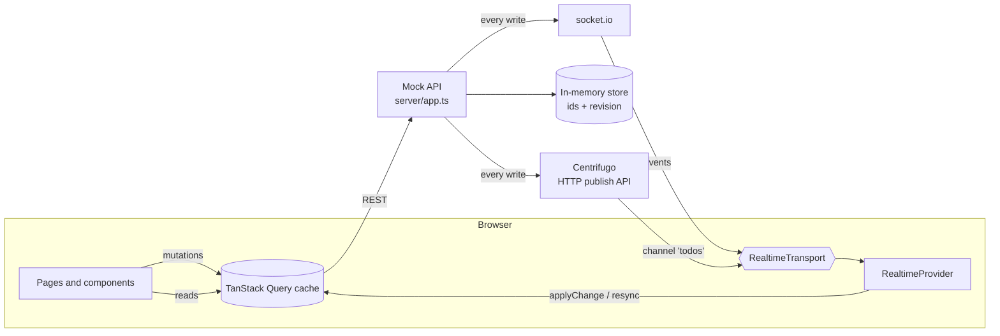

# Real-time Todos: Technical Notes

## 1. Problem

Build a todo client where task progress is shared live: when one person changes a task, everyone looking at the list sees it without reloading.

**Acceptance criteria**

- Todos load from the REST API and can be created, renamed and deleted.
- Each todo has a progress slider (0–100). Moving it saves the new value.
- A change made anywhere appears in every open client in real time, including creates and deletes.
- A client that loses its connection catches up when it reconnects.
- Each todo has its own page at `/todo/:id`.
- Failures are visible, and nothing the user typed is lost.

The 2024 version met the first two criteria and the detail page, and synced progress changes only. The 2026 rebuild covers the rest.

## 2. Architecture



**Data flow for one edit**

```mermaid
sequenceDiagram
  participant A as Tab A (socket.io)
  participant API as Mock API
  participant B as Tab B (Centrifugo)
  A->>A: drag slider: shown at once; after a 1 s pause the edit is saved
  A->>API: PATCH /api/todos/:id {progress}
  API-->>A: 200 change (revision n+1) → cache; the pending edit layer goes away
  API--)A: socket.io todo:updated, revision n+1 (already applied → ignored)
  API--)B: Centrifugo publication todo:updated, revision n+1
  B->>B: next revision → apply, highlight the card
```

**Responsibilities**

- `server/`: a store that owns ids and the revision counter; a small HTTP router; publishers for socket.io and Centrifugo. Every write returns its change and calls `publish(change)`, which fans out to both.
- `src/features/todos/queries.ts`: the `["todos"]` query and the create, update and delete mutations. Unsaved edits come from pending mutations and are layered over the server state for display.
- `src/features/todos/cache.ts`: pure functions for the ordering rule. `applyChange` applies the next revision and holds changes that skip ahead; `mergeList` keeps whichever of the cache and a fresh list is newer; `withPending` layers unsaved edits over the server state for display.
- `src/features/realtime/`: the `RealtimeTransport` interface, socket.io and Centrifugo implementations, and the provider that connects a transport to the cache. The route decides the transport: `/` uses socket.io and `/centrifugo` uses Centrifugo.

## 3. Key decisions

| Decision                                                                  | Why                                                                                                                                                                                                  | Trade-off                                                                                                                                                                 |
| ------------------------------------------------------------------------- | ---------------------------------------------------------------------------------------------------------------------------------------------------------------------------------------------------- | ------------------------------------------------------------------------------------------------------------------------------------------------------------------------- |
| TanStack Query for server state (2026) instead of Context (2024)          | Todos are server data. Caching, loading and error states, retries, refetching and optimistic rollback come built in. Socket events write straight into the cache                                     | One more dependency (~9 KB gzipped). The 2024 Context choice was reasonable for one slice of state, but it hand-rolled what Query provides                                |
| One server revision for all writes; responses are the broadcast change    | Events, responses and list loads arrive in any order and over different connections. A global, contiguous revision gives one rule: apply the next revision, ignore older ones, wait for missing ones | Every client tracks one number; the server serializes writes, which a single in-memory process does anyway                                                                |
| A change that skips revisions waits; reload after 1.5 s if the gap stays  | A write's response can beat an earlier broadcast, so waiting briefly avoids needless reloads; a real loss still recovers                                                                             | A missed change can take up to 1.5 s to appear                                                                                                                            |
| Unsaved edits are a display layer, not part of the cache                  | The cache only ever holds server state, so a newer change from someone else can't be hidden by an old edit, and a failed save needs no rollback: its layer just disappears                           | The display is derived on each render from pending mutations (`useMutationState`)                                                                                         |
| After an unrecovered (re)connect, compare revisions before reloading      | One small request tells whether anything was missed, so a page open costs one list load plus that check instead of two list loads                                                                    | An extra round trip after each unrecovered connect                                                                                                                        |
| Every change carries the id of the tab that made it (`origin`)            | A tab must not highlight its own echo, but must highlight everyone else's. Guessing from "a request is in flight" hid other people's changes made at the same moment                                 | One extra header on writes (`X-Client-Id`, a random id per tab) and one field on changes. The id is advisory: clients choose it, so it must not be used for authorisation |
| The Centrifugo client is loaded only on `/centrifugo`                     | It is ~99 KB minified that the default page never uses. The page renders at once from REST and shows "connecting" while the chunk downloads                                                          | A failed download shows "offline"; switching pages or reloading tries again. The download starts when the nav link is hovered or focused                                  |
| Server pushes full todos, not field patches                               | Creates, renames and progress changes all apply the same way                                                                                                                                         | Slightly larger payloads                                                                                                                                                  |
| A transport interface with two implementations                            | Shows that the app doesn't depend on socket.io, and lets the two be compared on the same UI                                                                                                          | A little indirection for one app                                                                                                                                          |
| socket.io with connection state recovery                                  | Auto-reconnect, named events, and replay of missed events after short disconnects (2 min, in server memory)                                                                                          | Needs a socket.io server; the recovery buffer is lost on restart, so the client falls back to a refetch                                                                   |
| Centrifugo with channel history and `force_recovery`                      | A separate real-time server: the backend publishes over HTTP and never holds connections. History (5 min here) lets clients recover by stream position; it scales out with Redis or NATS             | Another service to run; connection tokens (JWT) need a backend endpoint                                                                                                   |
| Optimistic edits; create waits for the server                             | Edits feel instant. Create needs a server id, and the form keeps the input until the server confirms                                                                                                 | A created todo appears after one round trip                                                                                                                               |
| Debounced progress saves (1 s) with flush on unmount and cancel on delete | One request per gesture; leaving the page never loses the last change; deleting never sends a stale save                                                                                             | Other users see a change up to a second later                                                                                                                             |
| Delete hides the todo now and calls the server after 5 s (Undo)           | Undo is friendlier than a confirmation dialog                                                                                                                                                        | Other users see the delete 5 s later                                                                                                                                      |
| Tailwind v4 + shadcn-style components instead of MUI                      | MUI and Emotion took ~40% of the bundle for three components. Radix gives an accessible slider                                                                                                       | Components are written in the repo instead of imported; JS went from 182.3 to 146.2 KB gzipped (measured at the commit before and after the swap)                         |
| Vite + Vitest + npm instead of Create React App                           | CRA is unmaintained; its Jest setup couldn't load ES-module packages without workarounds                                                                                                             | None worth noting for a project this size                                                                                                                                 |
| Mock server in TypeScript, run by Node 22's type stripping                | One `Todo` type for client and server, no build step for the server                                                                                                                                  | Requires Node 22.18+, and only erasable TypeScript syntax (no enums)                                                                                                      |

## 4. Accessibility

- One `h1` per page. Each todo is an `article` named by its title.
- Sliders are named `Progress for “<todo>”` and announce their value as a percentage. Rename and delete buttons include the todo's name, so a screen reader list of buttons makes sense.
- The rename field is labelled. Enter or leaving the field saves (so a phone keyboard's Done button doesn't lose the text); Escape or the Rename button cancels.
- Visible focus rings on every control. Filters are toggle buttons with `aria-pressed`, and the transport switch marks the current page with `aria-current`.
- Errors use `role="alert"`; connection status, loading text and the Undo notice use `role="status"`. Error notices stay until dismissed.
- The remote-change highlight is visual (a ring plus the text "Updated just now"). It isn't announced, to avoid a stream of announcements on a busy board.
- Todo titles are `h3` headings under the "Todos" `h2`.
- Checked with axe (WCAG 2.1 AA and best-practice rules) on every page in Playwright, and with a keyboard-only test that adds a todo and finishes it.

## 5. Testing strategy

| Layer                | Tool                                             | What it covers                                                                                                                                                                              |
| -------------------- | ------------------------------------------------ | ------------------------------------------------------------------------------------------------------------------------------------------------------------------------------------------- |
| Server               | Vitest (Node)                                    | Store rules (ids, contiguous revisions, validation), the HTTP API and CORS, socket.io broadcasts, JWT signing, the Centrifugo publish format, and logging when Centrifugo is down           |
| Pure logic           | Vitest                                           | Versioned cache updates, the fetch client's error messages, the debounce hook (flush, cancel, unmount)                                                                                      |
| Components and flows | Vitest + Testing Library + user-event            | Create, rename, delete with Undo, filters, empty, loading and error states, optimistic rollback, remote highlights (and none for this tab's own echo), connection status, transport routing |
| Network              | MSW                                              | Tests mock HTTP, not `fetch` or axios. The handlers reuse the server's store, so validation and revisions behave like the real API                                                          |
| Realtime             | Fake `socket.io-client` and `centrifuge` modules | Tests push server events and reconnects without a server                                                                                                                                    |
| End to end           | Playwright (Chromium)                            | Two browser contexts stay in sync over socket.io, over Centrifugo, and across the two; cutting a page's connection and restoring it brings back missed changes; axe; keyboard-only flow     |

Each 2026 bug fix started with a test that failed: the save sent after a delete, the cleared form after a failed create, "not found" while loading, and the abandoned rename draft. A review of the finished code found ten more problems, including a server crash on a malformed id and races between refetches, events and overlapping edits. A second review, of those fixes, showed that patching the races on the client still left two failure modes. That led to the server revision below. Each fix has a test that failed first wherever the behaviour is observable from outside. Coverage is 100% of statements, branches, functions and lines, and CI fails if it drops. CI runs format, lint, typecheck, coverage, the build, and the Playwright suite against a real Centrifugo container.

## 6. Looking back (2026)

What the 2024 version got right: a clear split between data and transport, server-pushed patches, local slider state for smooth dragging, and a written reason for the state-management choice.

What I changed, and why:

1. **Missed events.** Events sent while a client was offline were lost. Now socket.io and Centrifugo replay them, and the client refetches when they can't.
2. **Ids and ordering.** The client generated ids with `Math.random()`, and `PUT` returned the whole list, which could overwrite newer changes. The server now owns ids and a revision counter, and each write returns only its own change.
3. **Silent failures.** Errors went to the console. Now they're shown, edits roll back, and the form keeps its input.
4. **Debounce lifecycle.** A deleted card could still send its save. Saves are now cancelled on delete and flushed on unmount.
5. **Accessibility.** The slider pointed `aria-labelledby` at an element that didn't exist, and icon buttons were all named "edit" and "delete". Every control is now named after its todo.
6. **Tooling.** CRA, Yarn 1 and a Jest workaround for axios became Vite, Vitest and npm. One shared `Todo` type replaced two copies.

7. **Races between data sources.** A list response, a realtime event, a write's response and an unsaved edit can land in any order. My first fix used per-todo versions, an event journal and special cases on the client, and a review found two ways it could still go wrong. The fix that held was to let the server define the order: one revision per write, applied strictly in order, with unsaved edits kept out of the server state.

Still open: concurrent edits are last-write-wins, and the server is in memory only. Because of that, restarting the server resets the revision counter to 1, and a tab that stayed open across the restart ignores the new, lower revisions until it is reloaded. A persisted counter, or a server "epoch" id sent with the list and the revision check, would let clients notice and reload. Also open: a slider change still waiting out its 1 s delay is sent when its card disappears, so if someone else deleted that todo meanwhile, the save fails with a "not found" notice.

## 7. Roadmap

1. **Conflict handling:** send the revision the edit was based on with each `PATCH` and return `409` when the todo changed since, so the UI can show "someone else changed this".
2. **Persistence and auth:** a real backend (e.g. NestJS + Prisma + PostgreSQL) with users. Then Centrifugo connection tokens carry real user ids, and the store sits behind Redis.
3. **Presence:** "2 people viewing", using Centrifugo's built-in presence and socket.io rooms.
4. **Ordering:** drag to reorder, with a server-owned position.
5. **Deployment:** host the API and Centrifugo and link a live demo.
