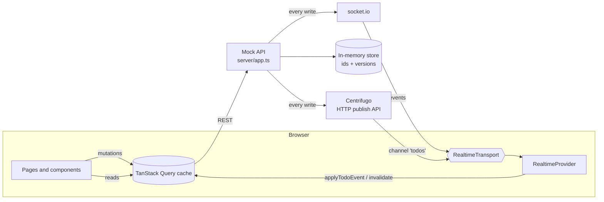
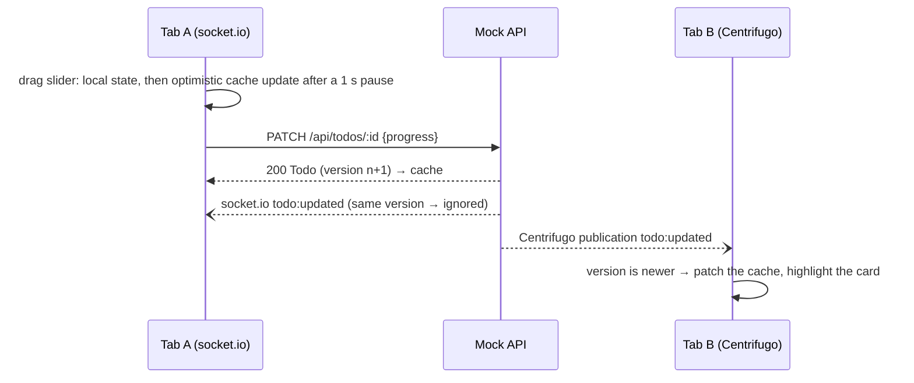

# Real-time Todos: Technical Notes

## 1. Problem

Build a todo client where task progress is shared live: when one person changes a task, everyone looking at the list sees it without reloading.

**Acceptance criteria**

- Todos load from the REST API and can be created, renamed and deleted.
- Each todo has a progress slider (0–100). Moving it saves the new value.
- A change made anywhere appears in every open client in real time, including creates and deletes.
- A client that loses its connection catches up when it reconnects.
- Each todo has its own page at `/todo/:id`.
- Failures are visible, and nothing the user typed is lost.

The 2024 version met the first two criteria and the detail page, and synced progress changes only. The 2026 rebuild covers the rest.

## 2. Architecture

**Data flow for one edit**

**Responsibilities**

- `server/`: a store that owns ids and versions; a small HTTP router; publishers for socket.io and Centrifugo. Every write calls `publish(event)`, which fans out to both.
- `src/todos/queries.ts`: the `["todos"]` query, plus mutations with optimistic updates and targeted rollback.
- `src/todos/journal.ts`: recent realtime events. Every list fetch replays the ones received while it was in flight, and keeps this tab's pending edits on top.
- `src/todos/cache.ts`: pure functions (`upsertTodo`, `applyTodoEvent`) that accept a todo only if its `version` is newer.
- `src/realtime/`: the `RealtimeTransport` interface, socket.io and Centrifugo implementations, and the provider that connects a transport to the cache. The route decides the transport: `/` uses socket.io and `/centrifugo` uses Centrifugo.

## 3. Key decisions

| Decision                                                                  | Why                                                                                                                                                                                      | Trade-off                                                                                                                                         |
| ------------------------------------------------------------------------- | ---------------------------------------------------------------------------------------------------------------------------------------------------------------------------------------- | ------------------------------------------------------------------------------------------------------------------------------------------------- |
| TanStack Query for server state (2026) instead of Context (2024)          | Todos are server data. Caching, loading and error states, retries, refetching and optimistic rollback come built in. Socket events write straight into the cache                         | One more dependency (~9 KB gzipped). The 2024 Context choice was reasonable for one slice of state, but it hand-rolled what Query provides        |
| Server-assigned `version` on every todo                                   | Events, `PATCH` responses and echoes of my own writes arrive in any order. Comparing versions makes applying them idempotent                                                             | Last write still wins between two users editing the same todo; versions prevent going back in time, not conflicts                                 |
| Replay recent events onto every list response                             | A list request can be answered before an event that reaches the tab first; replaying the journal keeps the newer state, and versions make it idempotent                                  | A bounded journal (500 events) in each tab                                                                                                        |
| Layer pending edits over server copies                                    | A response or broadcast for an earlier save has a higher version but older fields, and would snap a newer optimistic edit back                                                           | One helper used wherever server data enters the cache: responses, events and list fetches                                                         |
| First list load waits for the realtime connection (at most 1 s)           | No write can fall between the load and the subscription, and the page loads the list once instead of twice                                                                               | Up to a second's delay before the list shows when realtime is down                                                                                |
| Server pushes full todos, not field patches                               | With a version, a full todo can be applied safely, and creates and renames work the same way as progress                                                                                 | Slightly larger payloads                                                                                                                          |
| A transport interface with two implementations                            | Shows that the app doesn't depend on socket.io, and lets the two be compared on the same UI                                                                                              | A little indirection for one app                                                                                                                  |
| socket.io with connection state recovery                                  | Auto-reconnect, named events, and replay of missed events after short disconnects (2 min, in server memory)                                                                              | Needs a socket.io server; the recovery buffer is lost on restart, so the client falls back to a refetch                                           |
| Centrifugo with channel history and `force_recovery`                      | A separate real-time server: the backend publishes over HTTP and never holds connections. History (5 min here) lets clients recover by stream position; it scales out with Redis or NATS | Another service to run; connection tokens (JWT) need a backend endpoint                                                                           |
| Optimistic edits; create waits for the server                             | Edits feel instant. Create needs a server id, and the form keeps the input until the server confirms                                                                                     | Rollback logic: only the affected todo, and only if its version hasn't changed since                                                              |
| Debounced progress saves (1 s) with flush on unmount and cancel on delete | One request per gesture; leaving the page never loses the last change; deleting never sends a stale save                                                                                 | Other users see a change up to a second later                                                                                                     |
| Delete hides the todo now and calls the server after 5 s (Undo)           | Undo is friendlier than a confirmation dialog                                                                                                                                            | Other users see the delete 5 s later                                                                                                              |
| Tailwind v4 + shadcn-style components instead of MUI                      | MUI and Emotion took ~40% of the bundle for three components. Radix gives an accessible slider                                                                                           | Components are written in the repo instead of imported; JS went from 182.3 to 146.2 KB gzipped (measured at the commit before and after the swap) |
| Vite + Vitest + npm instead of Create React App                           | CRA is unmaintained; its Jest setup couldn't load ES-module packages without workarounds                                                                                                 | None worth noting for a project this size                                                                                                         |
| Mock server in TypeScript, run by Node 22's type stripping                | One `Todo` type for client and server, no build step for the server                                                                                                                      | Requires Node 22.18+, and only erasable TypeScript syntax (no enums)                                                                              |

## 4. Accessibility

- One `h1` per page. Each todo is an `article` named by its title.
- Sliders are named `Progress for “<todo>”` and announce their value as a percentage. Rename and delete buttons include the todo's name, so a screen reader list of buttons makes sense.
- The rename field is labelled. Enter or leaving the field saves (so a phone keyboard's Done button doesn't lose the text); Escape or the Rename button cancels.
- Visible focus rings on every control. Filters are toggle buttons with `aria-pressed`, and the transport switch marks the current page with `aria-current`.
- Errors use `role="alert"`; connection status, loading text and the Undo notice use `role="status"`. Error notices stay until dismissed.
- The remote-change highlight is visual (a ring plus the text "Updated just now"). It isn't announced, to avoid a stream of announcements on a busy board.
- Todo titles are `h3` headings under the "Todos" `h2`.
- Checked with axe (WCAG 2.1 AA and best-practice rules) on every page in Playwright, and with a keyboard-only test that adds a todo and finishes it.

## 5. Testing strategy

| Layer                | Tool                                             | What it covers                                                                                                                                                                              |
| -------------------- | ------------------------------------------------ | ------------------------------------------------------------------------------------------------------------------------------------------------------------------------------------------- |
| Server               | Vitest (Node)                                    | Store rules (ids, versions, validation), the HTTP API and CORS, socket.io broadcasts, JWT signing, the Centrifugo publish format, and logging when Centrifugo is down                       |
| Pure logic           | Vitest                                           | Versioned cache updates, the fetch client's error messages, the debounce hook (flush, cancel, unmount)                                                                                      |
| Components and flows | Vitest + Testing Library + user-event            | Create, rename, delete with Undo, filters, empty, loading and error states, optimistic rollback, remote highlights (and none for this tab's own echo), connection status, transport routing |
| Network              | MSW                                              | Tests mock HTTP, not `fetch` or axios. The handlers reuse the server's store, so validation and versions behave like the real API                                                           |
| Realtime             | Fake `socket.io-client` and `centrifuge` modules | Tests push server events and reconnects without a server                                                                                                                                    |
| End to end           | Playwright (Chromium)                            | Two browser contexts stay in sync over socket.io, over Centrifugo, and across the two; cutting a page's connection and restoring it brings back missed changes; axe; keyboard-only flow     |

Each 2026 bug fix started with a test that failed: the save sent after a delete, the cleared form after a failed create, "not found" while loading, and the abandoned rename draft. A later review of the finished code found ten more problems, including a server crash on a malformed id and races between refetches, events and overlapping edits. Each was fixed with a test that failed first wherever the behaviour is observable from outside. Coverage is 97% of lines. CI runs format, lint, typecheck, coverage, the build, and the Playwright suite against a real Centrifugo container.

## 6. Looking back (2026)

What the 2024 version got right: a clear split between data and transport, server-pushed patches, local slider state for smooth dragging, and a written reason for the state-management choice.

What I changed, and why:

1. **Missed events.** Events sent while a client was offline were lost. Now socket.io and Centrifugo replay them, and the client refetches when they can't.
2. **Ids and ordering.** The client generated ids with `Math.random()`, and `PUT` returned the whole list, which could overwrite newer changes. The server now owns ids and versions, and `PATCH` returns one todo.
3. **Silent failures.** Errors went to the console. Now they're shown, edits roll back, and the form keeps its input.
4. **Debounce lifecycle.** A deleted card could still send its save. Saves are now cancelled on delete and flushed on unmount.
5. **Accessibility.** The slider pointed `aria-labelledby` at an element that didn't exist, and icon buttons were all named "edit" and "delete". Every control is now named after its todo.
6. **Tooling.** CRA, Yarn 1 and a Jest workaround for axios became Vite, Vitest and npm. One shared `Todo` type replaced two copies.

7. **Races between data sources.** A list refetch, a realtime event and an optimistic edit can land in any order. Versions, the event journal and layering pending edits over server copies keep the newest state; the first list load waits for the realtime connection, so nothing falls into the gap between them.

Still open: concurrent edits are last-write-wins, and the server is in memory only.

## 7. Roadmap

1. **Conflict handling:** send the known `version` with each `PATCH` and return `409` when it's stale, so the UI can show "someone else changed this".
2. **Persistence and auth:** a real backend (e.g. NestJS + Prisma + PostgreSQL) with users. Then Centrifugo connection tokens carry real user ids, and the store sits behind Redis.
3. **Presence:** "2 people viewing", using Centrifugo's built-in presence and socket.io rooms.
4. **Ordering:** drag to reorder, with a server-owned position.
5. **Deployment:** host the API and Centrifugo and link a live demo.
